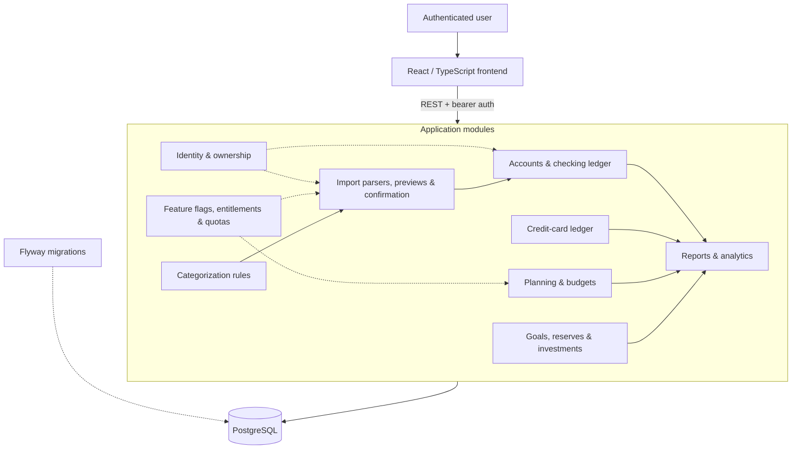
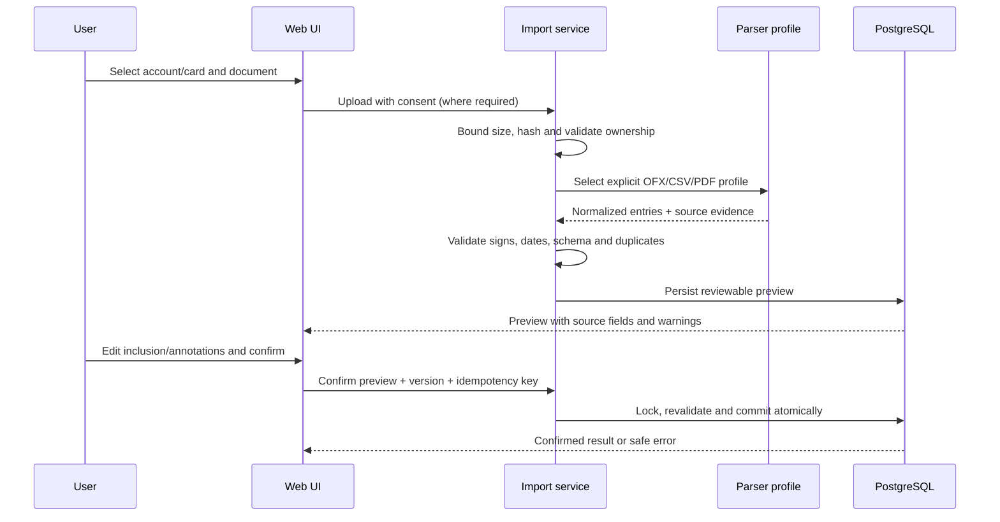

# Banking Intelligent Sheet

### A personal-finance workspace built around reviewable data and explicit financial meaning.

[Português](README.pt-BR.md) · [Architecture](docs/ARCHITECTURE.md) · [Financial invariants](docs/FINANCIAL_INVARIANTS.md) · [Import pipeline](docs/IMPORT_PIPELINE.md) · [AI safety](docs/AI_SAFETY.md) · [Roadmap](docs/ROADMAP.md) · [Privacy and security](docs/PRIVACY_AND_SECURITY.md)

  

> **Public engineering case study — not an open-source distribution or public launch.** The application repositories are private. This repository contains the product narrative, architecture decisions and verified limitations without exposing proprietary implementation, credentials or customer data.

## Banking Intelligent Sheet

Personal-finance data is usually split between bank statements, card invoices, manual notes and future plans. The difficult part is not drawing another chart; it is preserving the meaning of each record while importing imperfect documents and allowing a person to correct the result.

BIS therefore treats automation as a proposal: **ingest → validate → review → confirm → report**. A planned bill is not a paid debit, a card purchase is not automatically a second bank expense, and a model-generated PDF extraction is not an authoritative financial record.

## Engineering highlights

### 1. Confirmation is a financial transaction boundary

OFX and supported CSV imports are parsed into a persisted preview. The preview stores source facts, provenance and review state separately from confirmed account transactions. Confirmation runs in one PostgreSQL transaction: ownership, preview version, expiry, duplicate reservations and transaction inserts are checked before the preview is marked confirmed. If any validation fails, the write is rolled back instead of leaving half an import in the ledger. This costs an extra review step, but makes accidental posting and retry behavior explicit.

### 2. Ledgers are separated before they are aggregated

The backend keeps checking-account cash flow, credit-card activity, planning projections, goal movements, reserve movements and investment positions distinct. Reports label those scopes instead of adding every money-shaped row together. This is why a card purchase does not automatically become a bank expense and why a goal contribution does not silently debit an account. The trade-off is that a user sees several related views rather than one misleading “total”.

### 3. Duplicate safety uses trusted evidence, not fuzzy equality

Import confirmation reserves a statement by user, account and document digest. Trusted external transaction identifiers can be used only when the parser marks them as trusted; conflicting trusted IDs fail closed. Ambiguous records are not discarded merely because date, amount and description look similar. Database uniqueness constraints, confirmation idempotency keys and row locks make a repeated confirmation safe while preserving legitimate repeated purchases.

### 4. Budgets and alerts are derived from confirmed facts

Monthly budgets store limits, not a second copy of spending. `spent` is derived from confirmed bank transactions using `NUMERIC`/`BigDecimal`; income is excluded from expense totals. A global budget can provide a consolidated limit, while category budgets retain their own progress and are never summed into an artificial global ceiling. Threshold alerts use persisted generations and unique keys so recalculation does not emit duplicate events.

### 5. Access policy is three separate decisions

Operational feature flags, Free/Pro entitlements and usage quotas are evaluated independently. A feature flag cannot grant a commercial right, and a Pro entitlement cannot turn on a disabled or experimental operation. The effective decision is evaluated in the backend using the authenticated user context; the React UI only reflects that decision. This separation makes a kill switch useful without changing historical data or authorization rules.

### 6. AI is bounded and human-in-the-loop

PDF AI import is an experimental path. Preflight checks bound PDF size, page count and estimated tokens before a paid provider call. The current parser is pinned to `gemini-3.1-flash-lite`, one generation attempt, structured JSON and a maximum output-token limit. Reservations are atomic in PostgreSQL; cache hits do not generate another request; uncertain billing remains observable as `UNKNOWN_BILLING`. The application can enforce admission limits, but cannot promise an absolute provider billing ceiling. A validated response still becomes a reviewable preview, never an automatic confirmation.

## System architecture

The implementation is a modular monolith: one Spring Boot application with domain packages and one transactional PostgreSQL boundary, paired with a separately developed React application.

The monolith was chosen because confirmation, ownership and financial reconciliation need a shared transaction. It avoids distributed transactions and service-to-service retries while the product is still an MVP. The cost is that module boundaries are enforced by code conventions and package ownership rather than independent deployment; scaling and deployment isolation are deferred until there is evidence they are needed.

## Key design decisions

| Engineering problem | Chosen approach | Main trade-off | Deeper reading |
| --- | --- | --- | --- |
| Importing uncertain documents | Persist a preview, then require explicit confirmation | More user interaction | [Import pipeline](docs/IMPORT_PIPELINE.md) |
| Repeating a confirmation request | Idempotency keys, document reservations and unique constraints | More state to reconcile | [Import pipeline](docs/IMPORT_PIPELINE.md) |
| Mixing different financial meanings | Separate bank, card, planning, goal, reserve and investment ledgers | Reports need explicit scope labels | [Financial invariants](docs/FINANCIAL_INVARIANTS.md) |
| Overlapping budget limits | Derive consolidated spend from transactions; calculate each limit independently | No single “sum of all limits” number | [Financial invariants](docs/FINANCIAL_INVARIANTS.md) |
| Progressive access | Feature flag ∧ entitlement ∧ quota ∧ security policy | More combinations to test | [Architecture](docs/ARCHITECTURE.md) |
| PDF automation | Conservative preflight, one structured request, deterministic validation | Limited coverage and provider dependency | [AI safety](docs/AI_SAFETY.md) |
| Schema evolution | Flyway migrations and exact decimal columns | Changes require migration discipline | [Architecture](docs/ARCHITECTURE.md) |

## Financial data modeling

The system distinguishes facts that are often collapsed by spreadsheet-style applications:

- **Checking-account transactions** are confirmed realized cash flow. Positive and negative signed amounts are stored with account ownership and source provenance.
- **Credit-card purchases and invoices** form a separate ledger. A card invoice payment may appear in a bank statement, but the product does not infer a purchase-to-payment relationship from description text and does not add both rows to the same expense total.
- **Planning records** contain expected income and planned obligations. They are projections until a user records or confirms an actual movement.
- **Financial goals** use an auditable contribution/withdrawal ledger. Moving money toward a goal does not create bank income or expense.
- **Reserves and investments** have their own movements, positions and (for investments) manual valuation snapshots. The wealth view is explicitly partial; it is not a complete net-worth calculation.

The same rule applies to budgets: a confirmed expense can contribute to category progress, but a pending import, a planned obligation, an income row or a duplicate skipped during confirmation cannot. Reclassifying a transaction changes its category, not its amount or ledger.

## Import pipeline

The parser registry is profile-specific: a passing synthetic fixture is evidence for that profile, not universal bank compatibility. PDF AI adds external-consent, budget, evidence and reconciliation gates. Invalid documents, unsupported profiles, stale versions, ownership failures and ambiguous duplicates fail closed. See the [import deep dive](docs/IMPORT_PIPELINE.md) for the state and failure model.

## Reliability, consistency and concurrency

Financial writes use PostgreSQL transactions because updating a preview, a statement reservation, account transactions and audit state independently would permit partial confirmation. Confirmation locks the relevant user/preview/account rows, checks the optimistic preview version and uses unique constraints as a second line of defense. A repeated idempotency key returns the recorded outcome rather than inserting another transaction.

The same pattern appears in other domains: budget creation serializes the per-user Free limit; rule and budget updates use versions; entitlement transitions lock the user through commit; quota operations validate that an operation key belongs to the same user, quota, window and unit count. These are local database guarantees, not claims of a distributed lock service.

Identifiers generated by the model or an untrusted parser are not accepted as proof of uniqueness. Source page/evidence and trusted external IDs are retained for review, while ambiguous occurrences remain review-blocking. Rollbacks leave the confirmed ledger unchanged; uncertain AI billing is retained for operational reconciliation rather than silently released.

## Feature management and AI safety

Feature flags answer “is this operation available in this environment?” Entitlements answer “does this user have the right?” Quotas answer “is this usage still available?” The backend combines them, with plan denial taking precedence over an operational denial when both apply. Existing records remain readable when a write feature is disabled, and a kill switch blocks new work without rewriting financial history.

For AI PDF processing, `AiBudgetGuard` estimates an upper bound from extracted text, pages and configured output allowance before reserving budget. `AiImportService` checks consent, ownership, model/configuration, cache eligibility and the persistent kill switch before the single provider call. Provider failures may be `UNKNOWN_BILLING`; the reservation is deliberately not released automatically. A successful response must contain versioned structured data, verifiable source evidence and an independently reconciled balance equation before a preview is staged.

These controls are application safeguards, not a guarantee about Google's final invoice. The experimental feature is disabled by default and no provider credential belongs in the frontend. Details and operational limitations are in [AI safety](docs/AI_SAFETY.md).

## Testing and engineering quality

The private implementation repositories use layered checks rather than relying on one end-to-end script:

- JUnit tests cover parser grammar, validation, access policy, budget calculations, error contracts and state transitions.
- PostgreSQL/Testcontainers integration tests exercise import confirmation, ownership, migrations, budget/entitlement concurrency and repository constraints against a real database engine.
- The frontend uses Vitest and React Testing Library for capability-aware pages, import/review state, Portuguese error mapping and query invalidation. TypeScript, ESLint, encoding checks and a production Vite build run in CI.
- Playwright journeys are used selectively with synthetic data and disposable backends; they are evidence for the exercised path, not proof of every bank layout or production deployment scenario.
- GitHub Actions runs Maven formatting/verification, SpotBugs informational analysis, Trivy HIGH/CRITICAL scanning and Docker builds for the backend; the frontend workflow runs dependency installation, formatting, typecheck, lint, tests and image build.

Representative integration suites include import preview/confirmation failure paths, budget PostgreSQL scenarios, categorization rule persistence, entitlement/feature management, analytics and card import. The public repository does not publish private source or claim a universal coverage percentage.

## Current limitations

This is an internal MVP validation effort, not a public launch. OFX and CSV support is profile-specific; synthetic compatibility does not certify arbitrary bank exports. PDF AI is experimental, consent-gated and dependent on provider availability, evidence quality and budget admission. There is no Open Finance connection, no universal PDF/OCR promise, no live market-price feed, no automatic bank/card invoice reconciliation and no complete net-worth view. Free/Pro rights are modeled for controlled rollout, but checkout and announced pricing are not available.

The next honest milestones are broader authorized format validation, recovery/backup and observability review, accessibility and multi-user acceptance, and a closed-beta decision based on explicit release gates. See the [roadmap](docs/ROADMAP.md) for the distinction between implemented, manually checked and production-ready work.

## Further technical reading

- [Architecture and trade-offs](docs/ARCHITECTURE.md) — module boundaries, access policy and the modular-monolith rationale.
- [Financial invariants](docs/FINANCIAL_INVARIANTS.md) — ledger separation, budget semantics and consistency rules.
- [Import pipeline](docs/IMPORT_PIPELINE.md) — parser profiles, preview lifecycle, duplicate handling and confirmation.
- [AI safety](docs/AI_SAFETY.md) — admission budgets, cache/idempotency, unknown billing and privacy boundaries.
- [Privacy and security](docs/PRIVACY_AND_SECURITY.md) — public disclosure limits and data-handling intentions.
- [Public roadmap](docs/ROADMAP.md) — engineering flights and remaining release gates.

The project is independently developed by [Danilo Bruno da Silva](https://github.com/danilobsilv). References to financial institutions are contextual format research only and do not imply partnership or endorsement.
