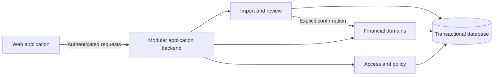
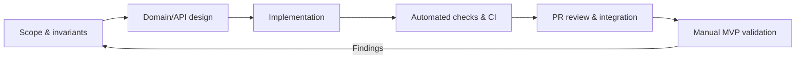

# Banking Intelligent Sheet

### Personal finance, with clarity and control.

**A privacy-conscious personal finance workspace built around explicit review, reliable accounting boundaries, and progressive product delivery.**

[Português](README.pt-BR.md) · [Architecture & diagrams](docs/ARCHITECTURE.md) · [Engineering decisions](docs/ARCHITECTURE.md#engineering-decisions-and-trade-offs) · [Roadmap](docs/ROADMAP.md) · [Privacy](docs/PRIVACY_AND_SECURITY.md)

  

> **Public engineering showcase — not an open-source distribution or public launch.** Backend and frontend live in private repositories. This repository documents the product, architectural reasoning, and development progress without exposing proprietary implementation.

## The problem

Personal financial activity is scattered across accounts, card records, statements, and spreadsheets. Importing the same statement twice, mixing card consumption with bank cash flow, or treating a future bill as an actual payment can make otherwise polished dashboards inaccurate.

**Banking Intelligent Sheet (BIS)** explores a workflow where trustworthy interpretation comes before automation: **ingest → validate → review → confirm → understand**.

## What has been built internally

| Capability | Design and current scope |
| --- | --- |
| Accounts & transactions | User-scoped accounts, categories, manual entries, and realized monthly cash-flow reporting |
| Statement ingestion | OFX and explicitly supported CSV profiles, with preview, review, duplicate detection, and confirmation; real-bank compatibility is format-specific and not broadly certified |
| Credit cards | Separate card ledger and experimental import workflows; no automatic cross-ledger payment reconciliation |
| Categorization | User-controlled matching rules, reviewable suggestions, and explicit historical reclassification |
| Budgeting | Monthly global and category-specific spending limits, without double-counting overlapping scopes |
| Planning | Expected income, scheduled expenses, recurring commitments, and separation from realized movements |
| Financial goals | Goal progress and auditable contributions/withdrawals in a separate ledger |
| Reserves & investments | Manual reserves, position movements, and valuation; partial wealth coverage rather than complete net worth |
| Reports | Monthly realized metrics, distinct planned and card views, and CSV export |
| Feature access | Operational feature controls separated from Free/Pro access rights; no public checkout |

These capabilities are **implemented internally**, not a claim of broad bank compatibility, production readiness, or public availability. A subset of flows has passed supervised synthetic-data browser checks; the broader MVP acceptance process continues.

## Architecture at a glance

**Why a modular monolith?** The financial workflows benefit from clear domain ownership and transaction boundaries more than they currently benefit from distributed deployment. Domain separation preserves the option to evolve later.

**Why separate ledgers?** A planned expense is not a bank debit; a card purchase is not necessarily a second bank expense; an investment valuation is not realized income. BIS models those distinctions before presenting aggregates.

See [architecture and trade-offs](docs/ARCHITECTURE.md) for the module map, lifecycle diagrams, and design choices.

## How we deliver: engineering flights

BIS is developed in **small, reviewable engineering flights**: cohesive increments with a defined domain objective, acceptance criteria, tests, and integration checkpoints.

The sequence has progressed from foundations and import integrity to domain capabilities, feature access, reporting, and the current **MVP stabilization/homologation flight**. Flights are organizational milestones, not a promise of deployment frequency or independently shipped services. See the [public roadmap](docs/ROADMAP.md).

## Technology & quality

| Area | Technologies / approach |
| --- | --- |
| Backend | Java 21, Spring Boot, modular monolith, REST APIs |
| Frontend | React, TypeScript, Vite, TanStack Query |
| Persistence | PostgreSQL, Flyway-managed migrations, exact decimal money |
| Quality | JUnit, PostgreSQL integration tests with Testcontainers, Vitest, CI |
| Development operations | Docker, Docker Compose, GitHub Actions, separate private implementation repositories |
| Design principles | Explicit consent and confirmation, ownership, auditability, idempotency, fail-closed experimental features |

## Current stage and honest boundaries

**Internal MVP validation; no public release.** Synthetic-data tests have exercised selected imports, duplicate handling, categorization, budgeting, planning, goals, and reserve movements. Testing uncovered UX refinements and integration questions still being tracked. Browser checks are not a substitute for independent security, real-bank format compatibility, recovery, or production operational reviews.

**Not claimed:** Open Finance connectivity, universal PDF parsing, live brokerage quotations, automatic bank/card reconciliation, complete net worth, available paid checkout, or verified compatibility with every institution.

The intended product entry point remains **free manual uploads and essential features**; advanced capabilities are modeled as Free/Pro entitlements for product experimentation, with **no announced pricing or purchasing flow**.

## Why the source is private

BIS is an independently built product under active development. Public pages intentionally omit internal schemas, endpoint inventories, provider integration specifics, credentials, operational topology, and other sensitive implementation details. This is a **portfolio and product-update repository**, not a distribution of the application or a security assurance.

Never post real financial data, account details, statements, or secrets in public issues. Read the [privacy and security boundary](docs/PRIVACY_AND_SECURITY.md).

**Built by [Danilo Bruno da Silva](https://github.com/danilobsilv).**

---

Independent project. References to financial institutions are contextual only and do not imply partnership or endorsement.
