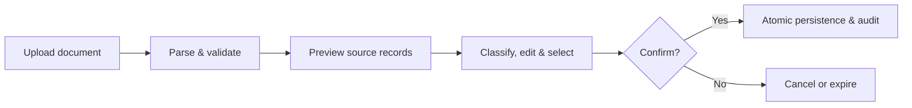

# Banking Intelligent Sheet

### Personal finance, with clarity and control.

**A privacy-conscious personal finance application for turning bank statements and credit card records into structured, reviewable financial insights.**

[Português](README.pt-BR.md) · [Architecture](docs/ARCHITECTURE.md) · [Roadmap](docs/ROADMAP.md) · [Privacy & Security](docs/PRIVACY_AND_SECURITY.md)

  

> **Project showcase repository.** The application is actively being developed. Its backend and frontend source repositories are private. This repository shares product goals, public architecture notes, and the roadmap; it is **not** a downloadable or hosted release.

## The problem

Financial information is fragmented across bank statements, credit card invoices, and manual records. Spreadsheet workflows often require repetitive data entry, while imported transactions can be difficult to verify, categorize, and reconcile.

**Banking Intelligent Sheet** explores a simpler approach: import financial records, inspect the original information, review every transaction, and confirm what should become part of your financial history.

## What the application does

| Capability | Current scope |
| --- | --- |
| Financial workspace | Manage accounts, categories, and manually recorded transactions |
| Cash-flow overview | Review monthly checking-account income and expenses |
| Bank statement imports | OFX parsing with preview and explicit confirmation |
| Credit card workspace | Manage cards, inspect card entries, and keep spending distinct from checking-account cash flow |
| Credit card CSV import | Experimental parsing, classification, review, and confirmation workflow; **real bank-export compatibility is not yet established** |
| Data review | Edit personal descriptions, notes, categories, and selection without rewriting immutable source data |
| Import safety | Ownership checks, audit trails, duplicate detection, idempotent confirmations, and transactional persistence |

### An import should never be a blind write

The design separates **original financial facts** (such as date, amount, and source description) from **personal annotations**. Credit card purchases, refunds, and payments are modeled separately from bank-account cash flow to avoid misleading totals.

## Technology stack

| Layer | Technologies |
| --- | --- |
| Backend | Java 21, Spring Boot, REST APIs |
| Frontend | React, TypeScript, Vite, TanStack Query |
| Data | PostgreSQL, Flyway migrations |
| Validation & testing | JUnit, PostgreSQL Testcontainers, Vitest |
| Infrastructure | Docker, Docker Compose, GitHub Actions |
| Design principles | Modular architecture, secure-by-default APIs, financial correctness, auditability |

The backend and frontend are developed as separate private repositories with independent CI pipelines and pull-request reviews.

## Engineering focus

- **Financial integrity:** `BigDecimal`/exact database monetary types, original-value provenance, and explicit confirmation before permanent writes.
- **Safe retries:** idempotency keys, PostgreSQL locking, and transactional rollback under failure or concurrent requests.
- **Privacy:** authenticated and user-scoped access, restricted file handling, sanitized errors, and no raw statement retention in the experimental import flow.
- **Explainable imports:** duplicate warnings are distinguished from confirmed duplicates; uncertain operations require user review.
- **Maintainability:** modular backend, typed frontend contracts, database migrations, integration tests, and CI.

For more detail, read the [public architecture overview](docs/ARCHITECTURE.md).

## Project status

**Active development — not publicly launched.**

**Implemented and integrated internally:** application foundation; authentication; essential account and transaction operations; OFX review/confirmation; credit card domain; experimental credit card CSV review/confirmation; and automated testing.

**In progress / before beta:** automatic cleanup of temporary import previews, operational hardening, deployment validation, and compatibility checks using authorized, anonymized bank-issued samples.

**Planned:** additional document formats and financial insights, prioritized after the existing import workflows are safe and validated.

See the [roadmap](docs/ROADMAP.md) for scope and limitations.

## Product direction

The intended entry-level experience is **free manual file uploads and essential personal finance organization**. Premium functionality may be explored later, but no paid plan, price, or launch date has been announced.

## Why is the source private?

This is an independently developed product in active iteration. Source code, internal implementation details, test infrastructure, and deployment configuration are kept in separate private repositories. Public documentation here is intended for transparency about the product and its engineering direction—not as a claim that the application is open source.

This repository does **not** contain customer data, real banking statements, API credentials, or production secrets. Please do not submit personal financial documents through public issues.

## Follow the project

Watch or star this repository for public updates as milestones are documented. Feedback on the product direction is welcome through GitHub Discussions or Issues **if those features are enabled**; never include sensitive financial data.

**Created by [Danilo Bruno da Silva](https://github.com/danilobsilv).**

---

Banking Intelligent Sheet is an independent project and is not affiliated with, endorsed by, or officially supported by any financial institution. Mentioned bank names identify potential document compatibility targets, not commercial partnerships.
