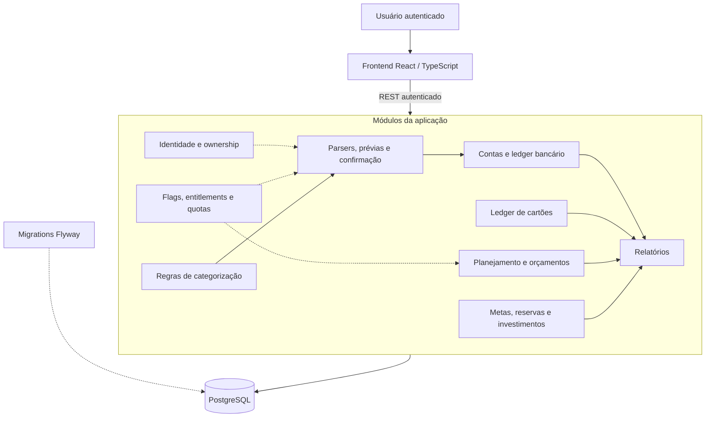
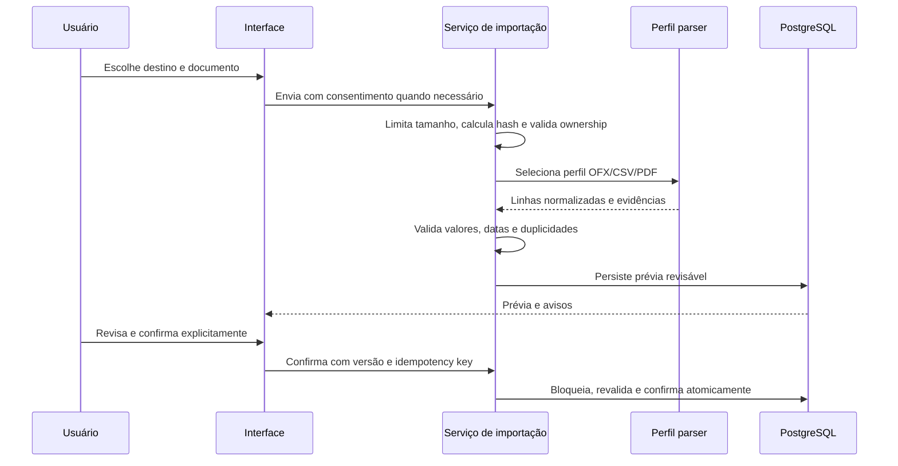

# Banking Intelligent Sheet

### Um ambiente de finanças pessoais baseado em revisão e significado financeiro explícito.

[English](README.md) · [Arquitetura](docs/ARCHITECTURE.md) · [Invariantes financeiros](docs/FINANCIAL_INVARIANTS.md) · [Pipeline de importação](docs/IMPORT_PIPELINE.md) · [Segurança de IA](docs/AI_SAFETY.md) · [Roadmap](docs/ROADMAP.md) · [Privacidade e segurança](docs/PRIVACY_AND_SECURITY.md)

> **Caso técnico público — não é distribuição open source nem lançamento público.** Os repositórios da aplicação são privados. Este repositório apresenta decisões e limites verificáveis sem publicar implementação proprietária, credenciais ou dados de clientes.

## Banking Intelligent Sheet

Dados financeiros ficam espalhados entre extratos, cartões, anotações e planos futuros. O desafio é preservar o significado de cada registro ao importar documentos imperfeitos e permitir correção humana antes de alterar o ledger.

Por isso, o BIS trata automação como proposta: **importar → validar → revisar → confirmar → analisar**. Uma conta a pagar não é um débito realizado, uma compra no cartão não é automaticamente uma segunda despesa bancária e uma extração de PDF feita por modelo não é um registro financeiro autoritativo.

## Destaques de engenharia

- **Confirmação como fronteira financeira.** OFX e perfis CSV suportados viram uma prévia persistida. A confirmação valida ownership, versão, expiração, duplicidades e registros relacionados em uma transação PostgreSQL. Falhas fazem rollback, em vez de deixar uma importação parcial.
- **Ledgers separados.** Fluxo bancário, atividade de cartão, planejamento, metas, reservas e investimentos têm significados diferentes. Relatórios mostram escopos identificados, evitando somar eventos incompatíveis.
- **Duplicidade baseada em evidência.** Digest do documento, reservas, chaves de idempotência, identificadores externos confiáveis e constraints protegem repetições sem descartar duas compras legítimas que apenas se parecem.
- **Orçamentos derivados.** O gasto vem de transações bancárias confirmadas e usa `NUMERIC`/`BigDecimal`. Limites globais e por categoria têm progresso próprio; limites sobrepostos não são somados para criar um teto artificial.
- **Acesso em camadas.** Feature flags, direitos Free/Pro, quotas e segurança são decisões distintas no backend. Uma flag não concede direito comercial e um direito Pro não liga uma operação experimental desligada.
- **IA controlada.** O PDF com Gemini é experimental, exige consentimento, passa por estimativa conservadora e reserva de orçamento, faz uma única chamada estruturada e termina em prévia para revisão humana. Incerteza de cobrança permanece observável como `UNKNOWN_BILLING`.

## Arquitetura

O sistema é um monólito modular Spring Boot com PostgreSQL transacional e um frontend React/TypeScript separado.

O monólito reduz transações distribuídas e retries entre serviços enquanto confirmação, ownership e reconciliação precisam de uma fronteira comum. O custo é que os limites de módulo são mantidos por código e testes, não por deploy independente.

## Modelo financeiro

- **Contas correntes:** transações confirmadas representam fluxo de caixa realizado.
- **Cartões:** compras e faturas pertencem a um ledger separado; não há reconciliação automática entre compra e pagamento da fatura.
- **Planejamento:** renda esperada e obrigações são projeções, não transações bancárias.
- **Metas:** contribuições e saques alteram o progresso da meta, sem criar débito ou crédito bancário automático.
- **Reservas e investimentos:** possuem movimentos e avaliações próprias; o patrimônio exibido é parcial, não um net worth completo.

Orçamentos usam as transações confirmadas da competência. Rendas, prévias, duplicidades descartadas e operações de outros ledgers não entram como despesa. Alterar a categoria altera classificação, não valor ou origem.

## Pipeline de importação

Perfis são específicos: um fixture sintético aprovado não certifica qualquer exportação bancária. Formatos inválidos, ownership incorreto, prévia expirada, conflitos de versão e duplicidades ambíguas falham fechados.

## Qualidade e limites

Os repositórios privados usam JUnit e Testcontainers para validação PostgreSQL, Vitest/React Testing Library no frontend, TypeScript, ESLint, build de produção e GitHub Actions. Playwright é usado seletivamente com dados sintéticos e ambientes descartáveis; não prova compatibilidade universal de bancos.

O MVP ainda não oferece Open Finance, OCR/PDF universal, cotações de mercado em tempo real, reconciliação automática banco-cartão, patrimônio completo ou checkout pago. OFX e CSV dependem de perfis explicitamente cadastrados. A IA permanece desligada por padrão e sujeita a consentimento, orçamento, disponibilidade do provedor e validação independente.

Leia os documentos de [arquitetura](docs/ARCHITECTURE.md), [invariantes](docs/FINANCIAL_INVARIANTS.md), [importação](docs/IMPORT_PIPELINE.md), [segurança de IA](docs/AI_SAFETY.md) e [roadmap](docs/ROADMAP.md) para os detalhes.

Projeto independente de [Danilo Bruno da Silva](https://github.com/danilobsilv). Referências a instituições financeiras são apenas pesquisa de formatos e não indicam parceria.
