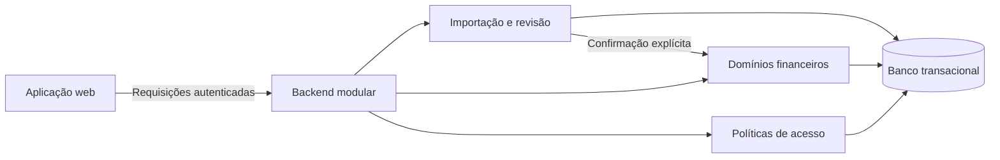
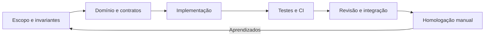

# Banking Intelligent Sheet

### Finanças pessoais com clareza e controle.

**Um ambiente de organização financeira pessoal com revisão explícita, integridade dos lançamentos e evolução incremental do produto.**

[English](README.md) · [Arquitetura e diagramas](docs/ARCHITECTURE.md) · [Decisões de engenharia](docs/ARCHITECTURE.md#engineering-decisions-and-trade-offs) · [Roadmap](docs/ROADMAP.md) · [Privacidade](docs/PRIVACY_AND_SECURITY.md)

> **Repositório público de apresentação técnica — não é um projeto open source nem um produto lançado.** Backend e frontend permanecem privados. Aqui compartilho a proposta, as decisões arquiteturais e a evolução do BIS, sem publicar sua implementação proprietária.

## O problema

Finanças pessoais ficam dispersas entre contas, cartões, extratos e planilhas. Importações duplicadas, mistura de consumo no cartão com fluxo bancário e confusão entre despesas previstas e efetivas geram relatórios pouco confiáveis.

O **Banking Intelligent Sheet (BIS)** prioriza a interpretação correta antes da automação: **importar → validar → revisar → confirmar → compreender**.

## O que já foi implementado internamente

| Área | Escopo e decisões |
| --- | --- |
| Contas e transações | Contas por usuário, categorias, lançamentos manuais e fluxo de caixa mensal realizado |
| Importação | OFX e perfis CSV explicitamente suportados, com prévia, revisão, detecção de duplicatas e confirmação; compatibilidade com bancos reais precisa ser validada por formato |
| Cartões | Ledger separado para cartão e fluxos experimentais de importação; sem reconciliação bancária automática da fatura |
| Categorização | Regras controladas pelo usuário, sugestões revisáveis e reclassificação histórica explícita |
| Orçamentos | Limites mensais globais e por categoria, sem somar indevidamente limites sobrepostos |
| Planejamento | Fontes de renda esperadas, despesas futuras, recorrência e distinção entre previsão e realização |
| Metas | Progresso e contribuições/saques auditáveis em ledger independente |
| Reservas e investimentos | Reservas e posições manuais, movimentos patrimoniais e avaliação manual; cobertura patrimonial parcial |
| Relatórios | Métricas mensais realizadas, visão separada de planejamento/cartões e exportação CSV |
| Acesso a recursos | Flags operacionais separadas de direitos Free/Pro; sem checkout público |

Esses módulos estão **implementados internamente**, mas não significam prontidão para produção, compatibilidade universal de extratos ou disponibilidade pública. Parte dos fluxos passou por homologação manual com dados sintéticos; a validação geral do MVP continua.

## Visão arquitetural

**Por que monólito modular?** Nesta fase, transações consistentes e fronteiras de domínio claras agregam mais valor do que distribuir prematuramente os serviços.

**Por que ledgers separados?** Despesa planejada não é débito bancário; compra no cartão não é automaticamente uma segunda despesa de conta; valorização patrimonial não é receita realizada.

Os diagramas completos, as decisões e os trade-offs estão na [documentação de arquitetura](docs/ARCHITECTURE.md).

## Como organizo os flights de engenharia

O desenvolvimento segue **flights incrementais**: entregas coesas de produto, com escopo definido, invariantes financeiros, testes automatizados, revisão e homologação.

As entregas evoluíram da infraestrutura e importações para módulos financeiros, controle de acesso, relatórios e a atual **fase de estabilização do MVP**. Flight é um marco de engenharia, não necessariamente um serviço independente ou um release público. Veja o [roadmap](docs/ROADMAP.md).

## Stack e qualidade

| Camada | Tecnologia / abordagem |
| --- | --- |
| Backend | Java 21, Spring Boot, APIs REST e monólito modular |
| Frontend | React, TypeScript, Vite e TanStack Query |
| Persistência | PostgreSQL, Flyway e tipos monetários exatos |
| Testes | JUnit, Testcontainers com PostgreSQL, Vitest e CI |
| Desenvolvimento | Docker, Docker Compose, GitHub Actions e repositórios privados separados |
| Princípios | Revisão humana, ownership, auditoria, idempotência e falha segura em recursos experimentais |

## Estado e limitações

**MVP em homologação interna; sem lançamento público.** Testes manuais com dados sintéticos cobriram cenários de importação, duplicidades, regras, orçamentos, planejamento, metas e reservas. Foram identificadas melhorias de UX e pontos de integração ainda sob avaliação.

**Não afirmamos oferecer:** Open Finance conectado, PDFs universais, cotações de investimentos em tempo real, conciliação automática entre banco e cartão, patrimônio líquido completo, compra de assinatura ou suporte comprovado a qualquer extrato bancário.

A direção comercial é manter **uploads manuais e recursos essenciais gratuitos**. Existem direitos de acesso Free/Pro para experimentação interna, mas ainda não há cobrança ou preço anunciado.

## Por que manter o código privado?

O BIS é um produto independente em construção. A documentação pública não divulga schemas completos, inventário de endpoints, detalhes de integrações, credenciais, topologia operacional ou implementações proprietárias. Este repositório serve para compartilhar a evolução do produto e o raciocínio técnico.

Não compartilhe extratos reais, dados pessoais ou credenciais em issues públicas. Leia os [limites de privacidade e segurança](docs/PRIVACY_AND_SECURITY.md).

**Desenvolvido por [Danilo Bruno da Silva](https://github.com/danilobsilv).**

---

Projeto independente. Nomes de instituições financeiras, quando mencionados, não implicam parceria ou endosso.
