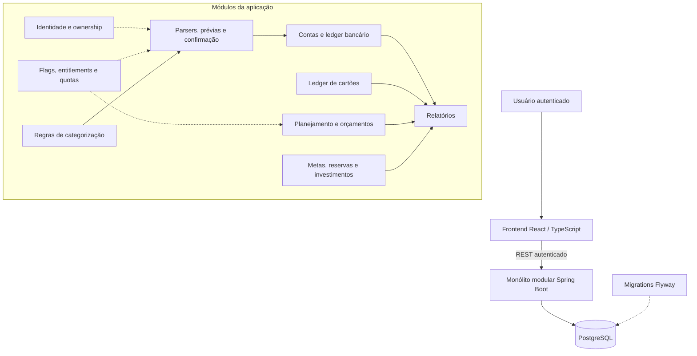
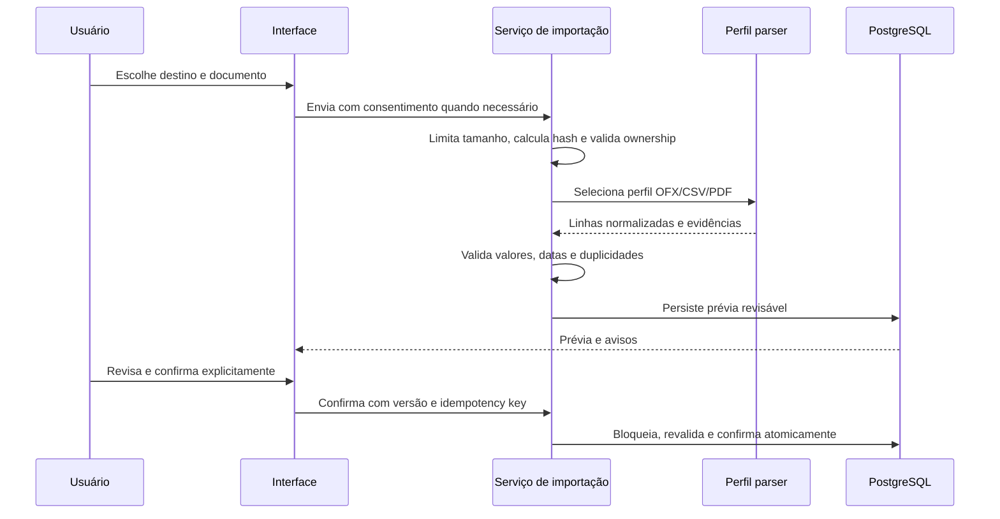

# Banking Intelligent Sheet

### Um ambiente de finanças pessoais baseado em revisão e significado financeiro explícito.

[English](README.md) · [Arquitetura](docs/ARCHITECTURE.md) · [Invariantes financeiros](docs/FINANCIAL_INVARIANTS.md) · [Pipeline de importação](docs/IMPORT_PIPELINE.md) · [Segurança de IA](docs/AI_SAFETY.md) · [Roadmap](docs/ROADMAP.md) · [Privacidade e segurança](docs/PRIVACY_AND_SECURITY.md)

> **Caso técnico público — não é distribuição open source nem lançamento público.** Os repositórios da aplicação são privados. Este repositório apresenta decisões e limites verificáveis sem publicar implementação proprietária, credenciais ou dados de clientes.

## Banking Intelligent Sheet

Dados financeiros ficam espalhados entre extratos, cartões, anotações e planos futuros. O desafio é preservar o significado de cada registro ao importar documentos imperfeitos e permitir correção humana antes de alterar o ledger.

Por isso, o BIS trata automação como proposta: **importar → validar → revisar → confirmar → analisar**. Uma conta a pagar não é um débito realizado, uma compra no cartão não é automaticamente uma segunda despesa bancária e uma extração de PDF feita por modelo não é um registro financeiro autoritativo.

## Mapa de capacidades

Os repositórios da aplicação são privados. A tabela resume o estado técnico sem transformar
implementação interna em promessa de produção:

| Capacidade | Estado atual | Limite da evidência |
| --- | --- | --- |
| Contas, transações manuais, categorias, dashboards e relatórios | Implementada internamente | Dados sintéticos e homologação supervisionada do MVP |
| Perfis registrados de extrato OFX e CSV | Implementada internamente | Testes por perfil; fixture sintético não certifica qualquer banco |
| Cartões, faturas e revisão de importação de cartão | Implementada internamente | Ledger separado e cobertura de integração selecionada |
| Orçamentos, metas, planejamento, reservas e investimentos | Implementada internamente | Movimentos separados; fluxos selecionados validados manualmente |
| Regras de categorização e reclassificação histórica | Implementada internamente | Prévia/confirmação explícitas e proteção de classificação manual |
| Entitlements Free/Pro e feature flags operacionais | Implementada para rollout controlado | Não há checkout, preço público ou assinatura comercial |
| Extração de PDF com Gemini | Experimental e controlada | Consentimento, quota e controles de custo; desligada por padrão |

Um módulo implementado ainda pode ter pendências de compatibilidade, recuperação, acessibilidade
ou operação. O [roadmap público](docs/ROADMAP.md) mantém essas diferenças explícitas.

## Fronteira dos repositórios

Este é o caso técnico público. A implementação vive no
[backend privado](https://github.com/danilobsilv/BankingIntelligentSheet---Backend) e no
[frontend privado](https://github.com/danilobsilv/BankingIntelligentSheet---Frontend). Os links
servem para contextualizar o projeto; este repositório não reproduz código proprietário,
segredos, fixtures privados ou dados de clientes.

## Destaques de engenharia

- **Confirmação como fronteira financeira.** OFX e perfis CSV suportados viram uma prévia persistida. A confirmação valida ownership, versão, expiração, duplicidades e registros relacionados em uma transação PostgreSQL. Falhas fazem rollback, em vez de deixar uma importação parcial.
- **Ledgers separados.** Fluxo bancário, atividade de cartão, planejamento, metas, reservas e investimentos têm significados diferentes. Relatórios mostram escopos identificados, evitando somar eventos incompatíveis.
- **Duplicidade baseada em evidência.** Digest do documento, reservas, chaves de idempotência, identificadores externos confiáveis e constraints protegem repetições sem descartar duas compras legítimas que apenas se parecem.
- **Orçamentos derivados.** O gasto vem de transações bancárias confirmadas e usa `NUMERIC`/`BigDecimal`. Limites globais e por categoria têm progresso próprio; limites sobrepostos não são somados para criar um teto artificial.
- **Acesso em camadas.** Feature flags, direitos Free/Pro, quotas e segurança são decisões distintas no backend. Uma flag não concede direito comercial e um direito Pro não liga uma operação experimental desligada.
- **IA controlada.** O PDF com Gemini é experimental, exige consentimento, passa por estimativa conservadora e reserva de orçamento, faz uma única chamada estruturada e termina em prévia para revisão humana. Incerteza de cobrança permanece observável como `UNKNOWN_BILLING`.

## Arquitetura

O sistema é um monólito modular Spring Boot com PostgreSQL transacional e um frontend React/TypeScript separado.

O monólito reduz transações distribuídas e retries entre serviços enquanto confirmação, ownership e reconciliação precisam de uma fronteira comum. O custo é que os limites de módulo são mantidos por código e testes, não por deploy independente.

## Modelo financeiro

- **Contas correntes:** transações confirmadas representam fluxo de caixa realizado. O `amount` persistido é uma magnitude positiva `NUMERIC(19,2)`; `direction` explicita `INCOME` ou `EXPENSE`, junto com ownership e proveniência.
- **Cartões:** compras e faturas pertencem a um ledger separado; não há reconciliação automática entre compra e pagamento da fatura.
- **Planejamento:** renda esperada e obrigações são projeções, não transações bancárias.
- **Metas:** contribuições e saques alteram o progresso da meta, sem criar débito ou crédito bancário automático.
- **Reservas e investimentos:** possuem movimentos e avaliações próprias; o patrimônio exibido é parcial, não um net worth completo.

Na fronteira do parser, adaptadores OFX/CSV e outros perfis podem carregar um valor de origem com
sinal (`+` para receita, `-` para despesa). A normalização deriva `direction` desse sinal e persiste
a magnitude absoluta. Os relatórios bancários somam o valor positivo armazenado filtrando por
direção. Outros ledgers usam valores positivos com um efeito explícito e aplicam esse efeito no
cálculo do saldo.

Orçamentos usam as transações confirmadas da competência. Rendas, prévias, duplicidades descartadas e operações de outros ledgers não entram como despesa. Alterar a categoria altera classificação, não valor ou origem.

## Pipeline de importação

Perfis são específicos: um fixture sintético aprovado não certifica qualquer exportação bancária. Formatos inválidos, ownership incorreto, prévia expirada, conflitos de versão e duplicidades ambíguas falham fechados.

### Falhas esperadas e decisões

| Falha ou incerteza | Comportamento esperado | Motivo |
| --- | --- | --- |
| Layout de arquivo não suportado | Rejeitar antes de criar transação confirmada | Não inventar datas ou valores |
| Prévia expirada ou editada | Retornar conflito seguro e exigir nova revisão | Preservar a versão revisada pelo usuário |
| Duplicidade apenas parecida | Manter para revisão ou falhar fechado | Não apagar uma compra legítima repetida |
| Resposta perdida na confirmação | Reusar a intenção original e consultar o resultado persistido | Evitar duplo lançamento |
| Identificador de outro usuário | Aplicar ownership no backend e o contrato de erro existente | A navegação do frontend não é segurança |
| Falha de provedor com cobrança incerta | Reter estado observável `UNKNOWN_BILLING` | Não liberar quota sem reconciliação |

## Consistência, concorrência e rollout

As escritas financeiras usam transações PostgreSQL, `NUMERIC`/`BigDecimal`, locks nas linhas
relevantes, constraints únicas e versionamento otimista. A confirmação revalida ownership,
expiração, versão, duplicidades e chave de idempotência antes de alterar o ledger. Repetir a mesma
intenção retorna o resultado persistido; não cria um segundo conjunto de transações.

Flags operacionais, entitlements e quotas são decisões diferentes. A flag controla disponibilidade
no ambiente, o entitlement controla o direito do plano e a quota controla uso. Nenhuma dessas
decisões substitui autenticação, ownership, consentimento ou validação financeira. O rollout parte
dos fluxos determinísticos; novos perfis e IA precisam de evidência própria e podem ser desligados
sem reescrever o histórico.

No PDF experimental, o backend verifica consentimento, configuração, limites de tamanho/páginas,
estimativa de tokens, reserva PostgreSQL, cache e resposta estruturada antes de criar uma prévia.
Uma resposta válida continua sujeita a revisão humana e nunca confirma movimentações sozinha.
Esses controles reduzem risco, mas não garantem a fatura final do provedor.

## Qualidade e limites

Os repositórios privados usam JUnit, Testcontainers e PostgreSQL real para importação, ownership,
migrations, budgets e concorrência; o frontend usa Vitest/React Testing Library, TypeScript,
ESLint, checks de encoding, build de produção e Playwright seletivo com dados sintéticos e
ambientes descartáveis. GitHub Actions separa formatação, compilação, testes, análise estática e
build de imagem. Isso não é um percentual de cobertura nem prova de compatibilidade universal.

As afirmações de CI acima referem-se aos repositórios privados de implementação. Este repositório
público contém documentação e não pretende compilar a aplicação.

O MVP ainda não oferece Open Finance, OCR/PDF universal, cotações de mercado em tempo real, reconciliação automática banco-cartão, patrimônio completo ou checkout pago. OFX e CSV dependem de perfis explicitamente cadastrados. A IA permanece desligada por padrão e sujeita a consentimento, orçamento, disponibilidade do provedor e validação independente.

## Leitura técnica

Leia [arquitetura](docs/ARCHITECTURE.md), [invariantes financeiros](docs/FINANCIAL_INVARIANTS.md),
[pipeline de importação](docs/IMPORT_PIPELINE.md), [segurança de IA](docs/AI_SAFETY.md),
[privacidade e segurança](docs/PRIVACY_AND_SECURITY.md) e [roadmap](docs/ROADMAP.md) para os
detalhes, trade-offs e gates de liberação.

Projeto independente de [Danilo Bruno da Silva](https://github.com/danilobsilv). Referências a instituições financeiras são apenas pesquisa de formatos e não indicam parceria.
