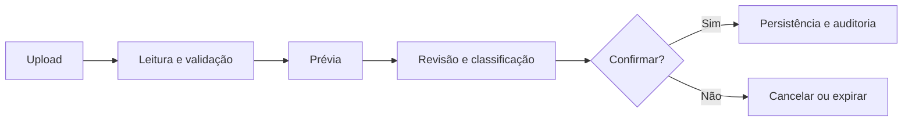

# Banking Intelligent Sheet

### Finanças pessoais com clareza e controle.

**Uma aplicação de organização financeira pessoal que transforma extratos e registros de cartões em informações estruturadas e revisáveis, com foco em privacidade.**

[English](README.md) · [Arquitetura](docs/ARCHITECTURE.md) · [Roadmap](docs/ROADMAP.md) · [Privacidade e segurança](docs/PRIVACY_AND_SECURITY.md)

> **Repositório público de apresentação.** O projeto está em desenvolvimento ativo. O código-fonte do backend e frontend permanece em repositórios privados. Este repositório apresenta o produto, suas decisões de engenharia e seu planejamento; **não é uma versão disponível para uso público**.

## O problema

Informações financeiras ficam dispersas entre extratos bancários, faturas de cartão e registros manuais. Manter planilhas atualizadas demanda trabalho repetitivo, e nem sempre é fácil verificar o que foi importado, classificado ou contabilizado.

O **Banking Intelligent Sheet** propõe um fluxo mais transparente: importar, inspecionar os dados originais, revisar os lançamentos e confirmar explicitamente o que entrará no histórico financeiro.

## Funcionalidades implementadas internamente

| Área | Recursos |
| --- | --- |
| Organização financeira | Contas, categorias, transações manuais e visão mensal de fluxo de caixa |
| Extratos bancários | Leitura OFX, prévia, revisão e confirmação |
| Cartões de crédito | Cadastro e separação das operações do fluxo de caixa das contas |
| CSV de cartão | Importação experimental com classificação, seleção e confirmação; **compatibilidade com exportações reais ainda não validada** |
| Integridade | Valores de origem preservados, auditoria, idempotência, prevenção de duplicatas e transações atômicas |
| Qualidade | Testes de integração, validações de frontend e CI |

## Como funciona uma importação

As informações originais do documento não são sobrescritas por descrições e categorias pessoais. Compras, estornos e pagamentos de cartão são tratados separadamente das movimentações bancárias para evitar dupla contabilização.

## Tecnologias

- **Backend:** Java 21, Spring Boot, REST APIs
- **Frontend:** React, TypeScript, Vite, TanStack Query
- **Persistência:** PostgreSQL e Flyway
- **Testes:** JUnit, Testcontainers, Vitest
- **Infraestrutura:** Docker, Docker Compose e GitHub Actions

## Estado do desenvolvimento

**Em desenvolvimento; ainda não lançado publicamente.** Já foram integrados os componentes essenciais, o fluxo OFX, o domínio de cartões e um fluxo experimental de CSV. Antes do beta, as prioridades são retenção segura de dados temporários, preparação operacional e validação de layouts de arquivos reais anonimizados.

Consulte o [roadmap](docs/ROADMAP.md) e a [arquitetura](docs/ARCHITECTURE.md).

## Proposta de acesso

A direção do produto é oferecer **upload manual gratuito e funcionalidades financeiras essenciais gratuitas**. Funcionalidades avançadas pagas podem ser consideradas futuramente, mas ainda não há planos ou preços definidos.

## Por que o código é privado?

Este é um produto independente em construção. Backend e frontend são desenvolvidos em repositórios privados, enquanto este espaço documenta publicamente a ideia, a evolução e os critérios de qualidade. Isso **não significa** que o projeto seja open source.

Não publique extratos, faturas, credenciais ou dados financeiros pessoais em issues públicas.

**Projeto de [Danilo Bruno da Silva](https://github.com/danilobsilv).**

---

Projeto independente, sem afiliação, patrocínio ou endosso de instituições financeiras mencionadas como possíveis fontes de arquivos.
