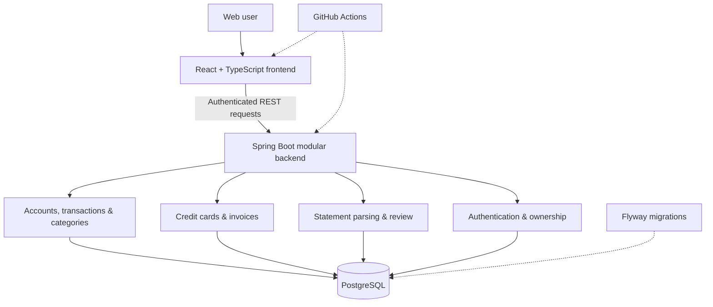

# Architecture overview

> This is a **public, high-level description**, not internal source-code documentation. Implementation code remains private, and architectural details may evolve during development.

## System boundaries

The frontend and backend are separately versioned and tested private codebases. The backend uses a modular monolith architecture rather than prematurely splitting financial transactions across distributed services.

## Import lifecycle

1. **Ingestion:** accept an authenticated upload with bounded size and an explicit supported format/profile.
2. **Parsing and validation:** normalize supported records and reject malformed or unsupported input without silently manufacturing missing financial facts.
3. **Preview:** retain normalized temporary rows, immutable source attributes, parser metadata, and review warnings; no permanent financial entry is inserted yet.
4. **User review:** choose which records to include, annotate descriptions and categories, and classify ambiguous card entries.
5. **Atomic confirmation:** validate ownership, state, expiry, version and duplicates; commit financial entries, preview outcome and audit event together.
6. **Safe retry:** reuse confirmation identity after uncertain network responses to avoid duplicate persistence.

## Financial semantics

| Financial event | Interpretation |
| --- | --- |
| Checking-account income or expense | Contributes to the checking-account cash-flow view |
| Credit-card purchase | Card consumption / obligation, **not** immediate checking-account cash outflow |
| Credit-card refund or adjustment | Reduces relevant card consumption/liability; **not** ordinary income |
| Credit-card invoice payment | Settles an obligation; **not** a second consumption expense |

The system intentionally does not present an inferred combined cash-flow/card-consumption total. Automated cross-instrument payment reconciliation is not implemented.

## Data and concurrency principles

- PostgreSQL with Flyway-managed, additive schema migrations.
- Exact monetary types (`BigDecimal` and database numeric columns).
- Authenticated, ownership-scoped operations.
- Immutable imported source values separated from editable personal metadata.
- Duplicate detection based on trusted identifiers or exact document provenance when available; heuristic similarity yields a review warning only.
- Confirmation protected by transaction boundaries and database locking.
- Testcontainers-backed PostgreSQL integration tests and frontend component/API contract tests.

## Security boundary and limitations

File ingestion avoids persistent storage of complete raw uploaded documents in the experimental workflow. Temporary normalized records exist for preview and provenance; their retention lifecycle is being hardened before beta. Production authentication, authorization, monitoring, backup and operational settings require ongoing validation.

**Experimental card CSV formats are backed by synthetic tests only.** Compatibility with specific bank-issued exports must be established separately before enabling public upload support.

For product priorities, see [Roadmap](ROADMAP.md). For disclosure guidance, see [Privacy and security](PRIVACY_AND_SECURITY.md).
