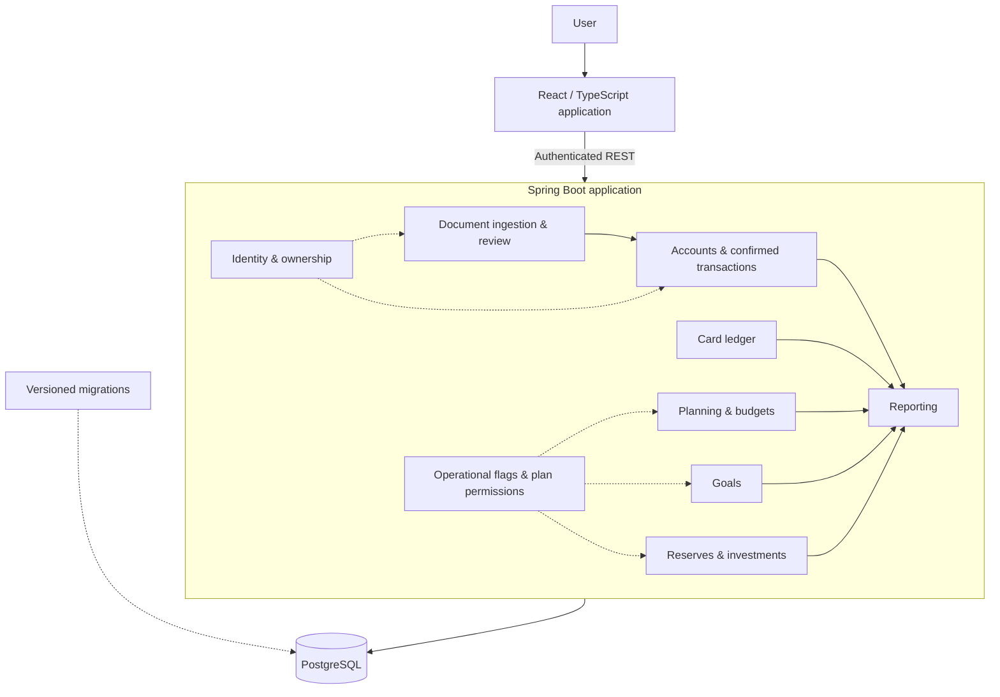
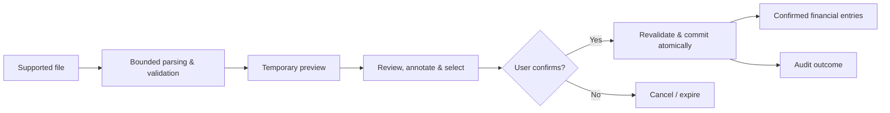
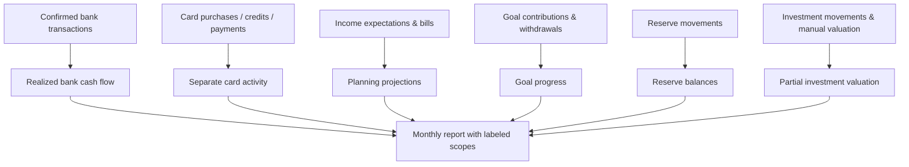
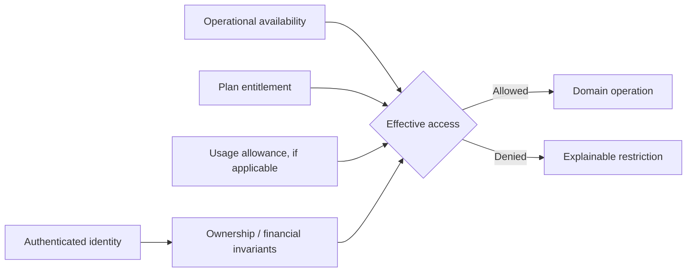
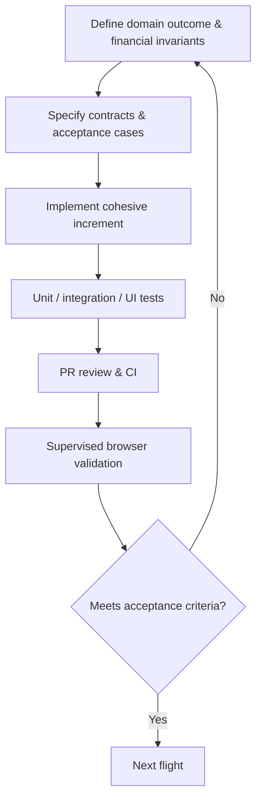

# Architecture & engineering decisions

> **Public conceptual overview.** This document explains decisions and system boundaries, not internal source code, implementation contracts, database definitions, deployment topology, or a claim of production security certification. The application source remains private.

## 1. Architectural approach

BIS is a **modular monolith**: one application backend with distinct financial domains and a transactional persistence boundary, paired with a separately developed React frontend.

**Architectural constraint:** a diagram arrow indicates a conceptual dependency or data flow; it does not imply an individually deployed service, public API endpoint, or direct SQL access between modules.

**Why now?** For a financial MVP, correctness, ownership and atomic confirmation are easier to reason about within a cohesive transactional system. A distributed microservice topology would introduce cross-service consistency and operational costs before demonstrated need.

## 2. Import as a stateful review workflow

The system preserves original source facts separately from user-editable annotations. It distinguishes **a reliable duplicate** from **a possibly similar record** rather than discarding ambiguous transactions automatically. Confirmation is the boundary between temporary reviewed data and durable financial records. Retried confirmation must not count the same import twice.

Import support is profile-specific. Passing synthetic OFX or CSV cases does **not** establish compatibility with arbitrary bank exports. PDFs and AI-assisted interpretation remain gated experimental areas, not generally available capabilities.

## 3. Separate financial meanings before aggregation

The most important modeling choice is to **avoid treating every money-related operation as an income or expense**.

| Domain event | Presentation rule |
| --- | --- |
| Confirmed bank income / expense | Included in realized cash flow for the selected period |
| Planned bill / expected income | Projection only, never a bank transaction without explicit action |
| Card purchase, adjustment, or invoice payment | Separate card domain; not automatically added to bank expenses |
| Goal contribution or withdrawal | Changes goal progress; no automatic bank debit or credit |
| Reserve deposit / withdrawal | Changes reserve ledger; no automatic bank debit or credit |
| Investment purchase / sale | Changes position and cost basis; not ordinary consumer spending |
| Manual valuation update | Snapshot of estimated value; not realized cash income |
| Partial wealth aggregate | Only registered reserves and investments; not complete net worth |

The monthly reporting layer intentionally labels what is **realized**, **planned**, **card-specific**, or **partial**. Global and category budgets overlap conceptually and must not be summed into an artificial spending limit.

## 4. Progressive access without mixing responsibilities

An enabled feature does not grant commercial entitlement. A Pro entitlement does not override a disabled experimental feature. Neither bypasses identity, ownership, validations, or financial integrity. This separation supports controlled experiments without tying feature deployment directly to future billing.

The internal Free/Pro catalog **is not an active checkout**. No public price, subscription purchasing, or general production availability is claimed.

## 5. Engineering decisions and trade-offs

| Decision | Why | Trade-off / deferred consideration |
| --- | --- | --- |
| Modular monolith | Cohesive transactions and clear bounded responsibilities | Independent service deployment deferred |
| PostgreSQL + versioned migrations | Exact monetary data and managed schema evolution | Requires careful migration and recovery discipline |
| Explicit import preview | Users inspect uncertain source facts before persistence | Additional interaction versus one-click ingestion |
| Conservative duplicate handling | Avoid accidental financial data loss | Some ambiguous duplicates need manual review |
| Independent financial ledgers | Prevent conflating intentions, card consumption, and bank cash flow | Requires deliberately scoped reports |
| Rule-based categorization first | Predictable, explainable suggestions | Less flexible than unconstrained inference |
| Optional, controlled AI | Cost/privacy controls and fallback to deterministic flows | Document coverage remains limited |
| Feature availability separate from entitlements | Operational safety does not equal commercial eligibility | More policy combinations to test |
| Separate private frontend/backend repositories | Independent tests and review workflows | Cross-repository integration must be validated |
| Synthetic-first validation | Reproducible, privacy-preserving regression cases | Does not prove actual bank-export compatibility |

## 6. Engineering flights & validation loop

A **flight** is a cohesive product/engineering increment, not a microservice and not a public release. Work has progressed through foundation, secure ingestion, core finance domains, richer planning, access controls, reporting, and the present MVP stabilization.

Selected recent synthetic-browser checks confirmed import retry behavior, historical rule application without changing transaction totals, recalculation of budgets and planning, and independent goal/reserve movements. This is **bounded validation evidence**; performance, complete security hardening, real export compatibility, and production operational readiness remain separate acceptance tracks.

For the public stage-by-stage overview, see [Roadmap](ROADMAP.md).

## 7. Disclosure boundary

This document deliberately excludes internal schema structure, proprietary algorithms, full endpoint inventories, feature-provider configuration, authentication internals, deployment details, incident procedures, and security-sensitive values. It describes **engineering rationale**, not a reproducible blueprint of the private product.

For data-handling intentions and limitations, see [Privacy & security](PRIVACY_AND_SECURITY.md).
