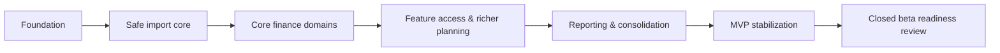

# Public roadmap & engineering flights

> **Status as of November 2026.** Milestones describe internal engineering progress, not a public launch promise. “Implemented” is different from “manually checked,” and both are different from “production-ready.”

## Delivery philosophy

BIS uses **cohesive engineering flights**: establish financial invariants → design a limited domain increment → implement and test → review through PR/CI → verify in the browser → fold learnings into the next increment. Work is intentionally organized to avoid broad releases of unverified financial behavior.

## How to read status

The roadmap uses three deliberately different evidence levels:

- **Implemented internally:** the private repositories contain the capability and its normal
  automated checks. This says nothing about universal bank compatibility or production operations.
- **Manually validated:** a documented supervised scenario passed with synthetic or explicitly
  authorized data. It is stronger than an untested code path, but narrower than a release claim.
- **Production-ready:** a future release gate requiring security, recovery, privacy, observability,
  compatibility, accessibility and support evidence in addition to passing tests.

An experimental feature can be implemented without being enabled. Operational flags, entitlements,
consent and quotas are rollout controls, not substitutes for the evidence required to promote a
capability.

## Internal engineering milestones

| Flight / theme | Internal implementation | Publicly defensible status |
| --- | --- | --- |
| Foundation | Java/Spring backend, React/TypeScript frontend, PostgreSQL migrations, Docker and CI | Implemented internally |
| Identity & core finance | Authenticated user scope, accounts, categories, transactions, monthly realized summaries | Implemented internally |
| Safe ingestion | OFX and scoped CSV profiles; review, explicit confirmation, duplicate/idempotency handling | Implemented; selected synthetic flows manually validated |
| Credit-card domain | Independent card activity and experimental import review | Implemented; real-bank layout compatibility remains limited |
| Feature management & Free/Pro | Operational controls, versioned access rights and quotas | Implemented internally; no public billing |
| Budgets & goals | Monthly global/category limits, goal progress and separate movement history | Implemented; selected synthetic flows manually validated |
| Categorization | Deterministic matching rules and explicit historical reclassification | Implemented; selected synthetic flows manually validated |
| Manual planning | Expected income, recurring obligations and separation from actual cash flow | Implemented; selected synthetic flows manually validated |
| Reserves & investments | Separate reserve and investment ledgers, manual valuation, partial wealth coverage | Implemented; reserve flows tested in internal validation; investment acceptance continues |
| Monthly reports | Distinct realized, planned, card and partial-wealth scopes; CSV export | Implemented; integration edge cases remain under review |
| MVP stabilization | Cross-module checks, UX refinement, error handling and consistency audits | **In progress** |

## What internal validation has and has not shown

Selected supervised tests using **synthetic data** exercised OFX confirmation and repeat import, CSV import, rule-based historical categorization, category budgets, planning records, financial-goal movements and reserve deposits/withdrawals/archive. These checks showed stable cash-flow totals under the tested separate-ledger operations.

They do **not** certify every use case or replace security testing, bank-issued sample validation, multi-user acceptance, restore testing, or production operations. Issues found during manual checks remain triaged before beta.

## Before any closed beta

- [ ] Complete finance-domain regression and cross-module acceptance checks.
- [ ] Reconcile remaining reporting and UI consistency questions.
- [ ] Validate any advertised bank export profile against authorized, anonymized real examples.
- [ ] Review privacy, lifecycle/retention, and operational safety controls.
- [ ] Validate deployment, backups/restoration, monitoring, and incident readiness.
- [ ] Establish explicit release gates and support/feedback mechanisms.

The beta decision must be made from this checklist and the evidence attached to the relevant
implementation PRs. A green unit-test suite alone is not a beta approval signal.

## Exploring later — not current product promises

- Additional verified institution-specific formats and document parsing.
- More advanced classification and explainable insights.
- Better UX, accessibility and multi-period reporting.
- Commercial upgrades only after product and operational validation.

## Deliberately out of scope / not claimed

No live Open Finance account connection, universal bank/PDF support, automatic matching of card invoices to checking-account debits, real-time market feeds, complete net worth, announced paid subscription price, or public launch date.

The intended entry experience is **free manual uploads and essential finance organization**. Internal Free/Pro capability modeling should not be confused with an available purchase flow.

The software remains proprietary and the application repositories are private.
